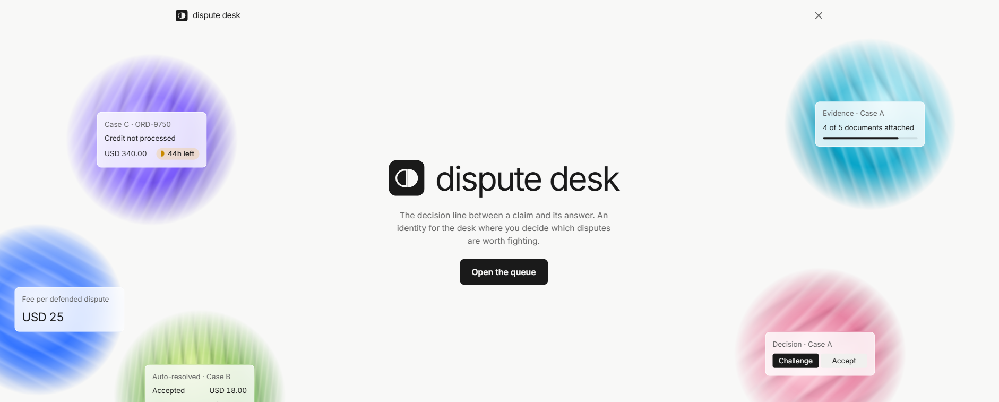
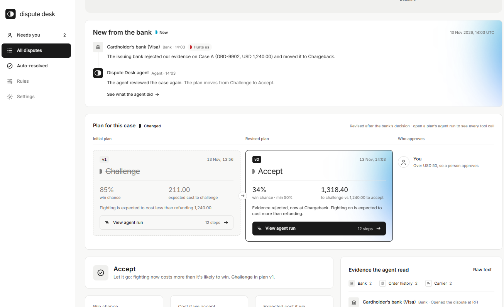
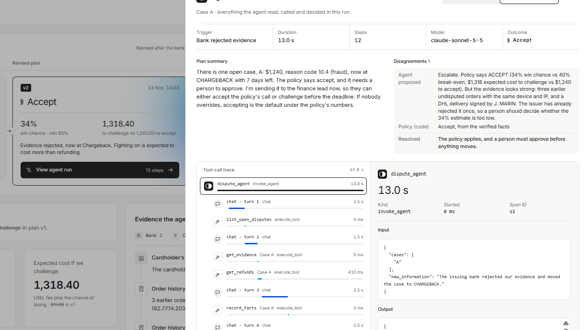
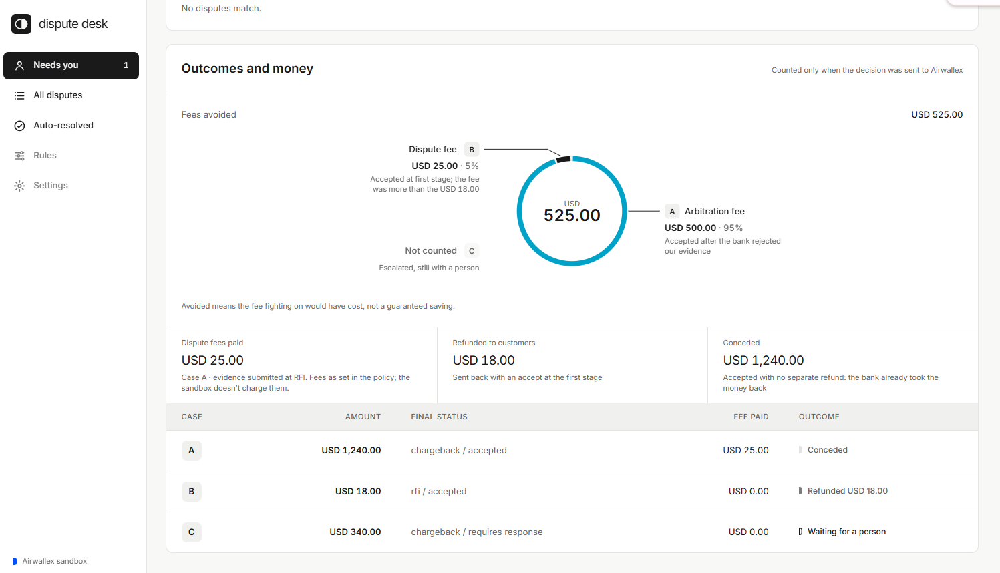
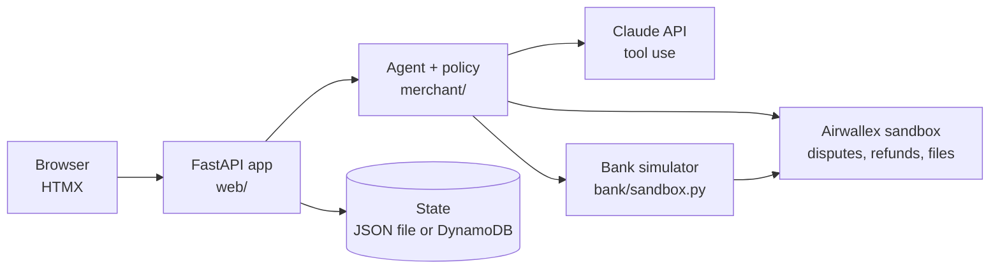

# Dispute Response Agent

An agent that works a merchant's chargeback queue on the **Airwallex sandbox**. For each dispute it decides whether to **challenge**, **accept**, or **hand it to a person**, moves real (sandbox) money and dispute state, asks a person before anything risky, and **changes its plan when the issuing bank pushes back**.

Built for the Airwallex agentic banking hackathon, **Kit 4: Dispute Response Agent**.

**Code decides the money. The model investigates and explains. A person approves.**

- **What it does:** reads three real sandbox disputes, decides challenge / accept / escalate with the fees in mind, and acts in Airwallex: refunds, evidence uploads, challenges, accepts.
- **What makes it an agent:** Claude works the queue through six typed tools, records only facts it can quote from the evidence, and plans again when the bank rejects our evidence. Every run is shown step by step.
- **How it ends:** a money action or a person: B refunded, A accepted after the plan changed from Challenge to Accept, C escalated with a reply draft. Fees avoided are counted only from actions Airwallex confirmed.



---

## The problem

A finance ops lead at an online merchant faces a queue of chargebacks. Each has a **deadline**, a **disputed amount** and some **order evidence**. Defending costs a fee **even if you win**, so fighting a small dispute can cost more than giving it up, and fighting a large one with weak evidence just loses money more slowly.

For every case the question is **challenge, accept, or escalate?**, and the right answer changes when the amount, the evidence, the deadline or the bank's response changes.

## The demo story

| Beat | What happens |
|---|---|
| **Goal** | Clear the queue before the deadlines without spending more on fees than we recover |
| **Queue** | Three disputes read from Airwallex: amount, Visa reason code, stage, deadline |
| **Initial plan (v1)** | The agent reads the evidence through its tools and proposes a plan; the policy decides each case: **challenge A** (needs approval), **accept B** (automatic), **escalate C** (urgent) |
| **Actions** | B is accepted with a refund. C goes to a person with a reply draft and a checklist. A's evidence PDF is uploaded and the challenge is sent after a person approves |
| **New information** | The issuing bank rejects A's evidence: RFI → CHARGEBACK |
| **Revised plan (v2)** | The agent runs again. Win chance drops from 85% to 34% and fighting on now costs a $500 arbitration fee, so A switches **CHALLENGE → ACCEPT**. The case page shows v1 next to v2, and a person approves v2 |
| **Result** | Final statuses read back from Airwallex, plus the money: **fees avoided USD 525.00** (A's $500 arbitration fee, B's $25 dispute fee), refunded USD 18.00, C still with a person |

Every run the agent makes is visible: open **View agent run** on a plan to see each model turn and tool call, with inputs, outputs and timings.

**Case A after the bank's rejection:** the bank's news, then plan v1 next to v2, each with the agent run that produced it.



### A real run

The run behind plan v2, as recorded (screenshot below):

| | |
|---|---|
| **Trigger** | Bank rejected evidence |
| **Model** | `claude-sonnet-5-5` |
| **Duration** | 13.0 s: about 12.3 s in 5 model turns, the 6 tool calls well under a second together |
| **Steps** | 12: the agent span, 5 model turns, 6 tool calls (`list_open_disputes`, `get_evidence`, `get_refunds`, `record_facts`, `evaluate_policy`, `submit_plan`) |
| **Outcome** | Accept, from the policy |
| **Disagreement** | The model proposed **Escalate**: *"the evidence looks strong … the issuer has already rejected it once, so a person should decide whether the 34% estimate is too low."* The policy said **Accept**. Result: the policy applies, and a person must approve before anything moves |

This is the design working as intended: the model pushed back with a reason, code kept control of the money, and the disagreement added a person rather than changing the decision.



### The three cases

| Case | Claim | Amount | Evidence | Decision |
|---|---|---|---|---|
| **A** | Fraud (Visa 10.4) | $1,240 | Same device fingerprint and IP as 3 earlier undisputed orders; delivery signed for | **Challenge** (approval needed); after the bank rejects: **Accept** |
| **B** | Not received (Visa 13.1) | $18 | Delivery scan, but no signature and no photo | **Accept + refund** automatically: the $25 fee is more than the amount |
| **C** | Credit not processed (Visa 13.6) | $340 | Customer emailed support twice, no reply; return never logged | **Escalate** to a person, flagged URGENT (2 days left) |

## Why an agent

- **The evidence is messy text.** Order tables, carrier logs and support emails don't fit a form. The model reads them and records facts, but every fact must quote the evidence **word for word**, and code checks each quote before the fact is accepted.
- **The right action depends on what happens next.** The agent works in a loop and runs again when the bank responds. New information (the rejection) changes its facts, the policy's numbers and the plan, and the page shows both versions.
- **A finance lead needs the reason, not just the verdict.** The model explains each decision in plain language, including why a decision changed.

Why it is **not** fully autonomous: every money outcome comes from the policy in code. The model can only *add* scrutiny. If it disagrees with the policy, the policy still applies and a person must approve. Approvals are locked to the exact terms the person saw.

## How it works

| Piece | Job | Where |
|---|---|---|
| **Agent loop** | The model works the queue through typed tools: list disputes, read evidence, check refunds, record quoted facts, ask the policy, submit a plan. Code runs every tool and records each step as a timed span | `merchant/agent_loop.py`, `merchant/tools.py` |
| **Policy** | Every money rule: fees, win chance, expected cost, thresholds, deadlines, who must approve | `merchant/policy.py` |
| **Agent** | Turns the run into decisions: verified facts → policy → approval or action. Falls back to a fixed evidence reader if the model fails, so a bad run never blocks or changes a money decision | `merchant/agent.py`, `merchant/reader.py` |
| **Explanations** | Plain-language reasons, including what changed after new information | `merchant/explainer.py` |
| **Approvals** | Locks the approved terms to a fingerprint and re-checks them against live Airwallex data before acting | `merchant/approvals.py` |
| **Actions** | Accept (with refund at RFI), challenge with an evidence file; each once, with a `request_id` | `merchant/actions.py`, `merchant/evidence_files.py` |
| **Bank simulator** | Opens disputes and rejects evidence through one interface | `bank/sandbox.py` |
| **Web app** | Queue, case pages, plan v1 vs v2, approvals, agent run drawer, money summary | `web/` |

The six tools are: `list_open_disputes`, `get_evidence`, `get_refunds`, `record_facts`, `evaluate_policy`, `submit_plan`. **None of them can move money or simulate the bank**, and a test checks that. The model never sees Airwallex credentials.

## The brief, and where it lives in the code

| Requirement | How it's met | Where |
|---|---|---|
| Makes a financial decision | Challenge, accept or escalate by comparing the expected cost of fighting with the amount at stake | `policy.decide()` |
| Chooses differently when new information arrives | The bank's rejection reaches the agent; the policy counts the $500 arbitration fee and lowers the win chance; the plan moves CHALLENGE → ACCEPT; v1 and v2 are both kept and shown | `bank/reject.py`, `agent.plan_with_run()`, `policy.py`, `service.record_plans()`, `web/view.revision()` |
| Moves money or updates state | Accepts disputes (with a refund at RFI), uploads evidence and challenges; escalates to a person's queue | `merchant/actions.py`, `merchant/evidence_files.py`, `merchant/approvals.escalate()` |
| States what needs approval | Over $50 or after a rejection needs a person; so does any case where the model disagrees with the policy, or the run didn't finish | `policy.decide()` (`needs_human`), `agent.plan_with_run()` |
| Rules, limits, duplicate protection and state transitions in code | Thresholds in one place; one `request_id` per operation; each action recorded once per dispute and stage; stage guards; optimistic locking on saved state | `policy.py`, `records/state.py`, `actions.py` |
| The model reads text, compares evidence, proposes and explains | Tool loop with quote-checked facts; a plan with reasons; disagreements recorded | `agent_loop.py`, `tools.record_facts()`, `tools.submit_plan()`, `explainer.py` |
| Typed tools | JSON schemas; code validates every call and refuses bad input | `tools.TOOL_SPECS`, `tools.dispatch()` |
| Approvals bound to amount, currency, counterparty, terms and evidence | SHA-256 fingerprint of action, amount, currency, customer, order, product, reason code, stage and evidence file, re-checked against live data | `approvals.terms_shown()`, `approvals.verify_approval()` |
| Sandbox simulation behind one interface | `DisputeSimulator`, swappable for a real issuer feed or a test fake | `bank/sandbox.py` |
| Demo: goal → plan → new information → revised decision → result | Queue, plan card (v1 vs v2), "New from the bank", agent run drawer, Outcomes and money | `web/templates/partials/` |
| Ends with a financial action or an escalation | A accepted after approval, B refunded, C escalated with a reply draft and checklist | `actions.accept()`, `agent.resolve_escalation()` |

## Decision rules and where the numbers come from

All numbers are **demo assumptions**, kept in one place (`merchant/policy.py`):

| Setting | Value | Meaning |
|---|---|---|
| `DISPUTE_FEE` | $25 | Paid whenever we defend, win or lose |
| `ARBITRATION_FEE` | $500 | Cost of fighting on after the bank rejects our evidence |
| `AUTO_APPROVE_LIMIT` | $50 | Above this, a person approves |
| `MIN_CHALLENGE_PROB` | 50% | Don't fight weak cases |
| `REJECTION_FACTOR` | 0.4 | After a rejection, the win chance drops to 40% of what it was |
| `MIN_DAYS_TO_CHALLENGE` | 2 days | Less time and no evidence prepared: a person decides |
| `URGENT_DAYS` | 3 days | Needs a person and less time: flagged URGENT |

Rules, checked in order:
1. **Fee ≥ amount → accept.** Even a certain win loses money (case B).
2. **Customer contacted support 2+ times with no reply and no refund → escalate.** The merchant may owe a refund; a person decides (case C).
3. **Otherwise compare expected costs.** Challenge only if the win chance is at least 50% **and** `fee + (1 − p) × amount` is less than the amount. After a rejection the first fee is already spent, so only the $500 arbitration fee counts (case A, before and after).
   - Worth challenging but under 2 days left and no evidence prepared → **escalate as URGENT** rather than give up money because of the clock.

**Win chances are not learned from data.** They are a simple score per claim type, for example fraud: 15% base, +55% for Visa Compelling Evidence 3.0-style device and IP matches, +15% for a signed delivery = **85%** for case A, then × 0.4 after the rejection = **34%**. A real merchant would replace these weights with its own historical win rates.

**Fees avoided** counts only accepts that Airwallex confirmed: the fee fighting on would have cost ($500 after a rejection, otherwise $25). It is not a guaranteed saving, and the sandbox doesn't actually charge dispute fees, so the app applies them in code.



*The end of the demo: A accepted after the plan changed (USD 500.00 arbitration fee avoided), B refunded (USD 25.00 dispute fee avoided), C still with a person. Fees avoided: USD 525.00.*

## Safety and correctness

- **Approvals are bound to what the person saw.** The fingerprint covers the terms above. Right before acting, the server recomputes it from live Airwallex data; if anything changed, the approval is refused.
- **No double refunds.** A refund is only attached at RFI (at CHARGEBACK the bank has already taken the money back), and the refund records are checked first.
- **Idempotency.** One `request_id` per operation, reused on retries; each action is logged once per dispute and stage, so reruns never repeat anything.
- **State transitions in code.** Guards refuse to act on closed or expired disputes or at stages that don't allow the action.
- **Saved state can't be silently overwritten.** With the DynamoDB backend, saves are conditional on a version number (optimistic locking); a conflicting save reruns the step once on fresh data.
- **The model can't move money.** It has no Airwallex credentials and no money-moving tool; the evidence is treated as data, not instructions.
- **Sandbox only.** The app refuses to start unless the API URLs are sandbox URLs, and uses a scoped key with no payout, transfer or FX permissions.

## Payments: payment links, not create + confirm

Disputes in the sandbox need real (test) card payments to dispute. Creating and confirming a payment intent with raw card details returned *"not enabled for native API access"* on our account. So the demo payments are made through **Airwallex-hosted payment links**: a person pays with a test card on Airwallex's checkout page, and our server never handles card numbers. The app then records those payments and opens the disputes through the sandbox simulator. `merchant/payments.py` keeps the direct create-and-confirm version for accounts with native API access.

## Architecture



- **Reviews run in the background.** `POST /review` starts the agent in a background thread and answers at once with a job id. The page polls `GET /review/{id}/progress` every 500 ms and lists each model turn and tool call as it finishes, then redraws itself.
- **Agent runs are kept per plan version.** Each run stores its spans (agent, model turns, tool calls) with inputs, outputs and timings. Each plan version records the run that produced it, so the case page can open the run behind v1 or v2.
- **State** is a JSON file locally or one DynamoDB item (`STATE_BACKEND=dynamodb`). The table is defined with AWS CDK in `infra/`.

## Airwallex endpoints used

| Endpoint | Used for |
|---|---|
| `POST /api/v1/authentication/login` | Bearer token (refreshed automatically) |
| `GET /pa/payment_intents` | Recording the paid demo orders |
| `POST /simulation/pa/payment_disputes/create` | The bank opens disputes (A and B at RFI, C at CHARGEBACK) |
| `GET /pa/payment_disputes`, `GET /pa/payment_disputes/{id}` | Reading the queue and live dispute state |
| `POST /files/upload` (files host) | Uploading A's evidence PDF |
| `POST /pa/payment_disputes/{id}/challenge` | Challenging A with `PURCHASE_HISTORY` and the evidence file |
| `POST /pa/payment_disputes/{id}/accept` | Accepting B (`LOW_VALUE_TRANSACTION` + refund), A after the rejection, and escalated cases a person resolves |
| `POST /simulation/pa/payment_disputes/{id}/escalate` | The bank rejects A's evidence |
| `POST /simulation/pa/payment_disputes/{id}/resolve` | Final ruling, for disputes still being argued |
| `GET /pa/refunds` | Confirming B's refund and the double-refund guard |

## Project structure

```
core/        config.py (sandbox-only settings), client.py (login, token refresh, errors)
bank/        sandbox.py (simulator interface), seed.py (open disputes),
             reject.py (bank rejects evidence), resolve.py (final ruling)
merchant/    agent_loop.py + tools.py (model and typed tools), agent.py (decisions),
             policy.py, reader.py (fallback), explainer.py, approvals.py,
             actions.py, evidence_files.py, refunds.py, queue.py, record_payments.py
records/     cases.py, evidence_text.py, state.py (file or DynamoDB),
             progress.py (live review progress), reset.py, migrate_to_dynamodb.py
web/         main.py (routes), service.py (page data), view.py (formatting),
             templates/, static/
infra/       AWS CDK: the DynamoDB state table
tests/       114 tests: policy, approvals, agent loop, agent runs, state, web, fees
app.py       earlier Streamlit UI, kept for reference
```

## Run it locally

**1. Install**
```bash
python -m venv .venv
# Windows: .venv\Scripts\Activate.ps1   macOS/Linux: source .venv/bin/activate
pip install -r requirements.txt
```

**2. Configure `.env`** (never commit it)
```env
AWX_CLIENT_ID=...
AWX_API_KEY=...              # scoped sandbox key
ANTHROPIC_API_KEY=...
ANTHROPIC_MODEL=claude-sonnet-5-5
# optional: STATE_BACKEND=dynamodb  (default: a local JSON file)
```
Scoped key permissions: **Payment Acceptance** (read/write), **Payment Disputes** (read/write), **Simulations** (write), **Upload Files** (write, global), optionally **Balances** (read).

**3. Fresh data**
```bash
python -m records.reset
```
Then create and pay three USD payment links ($1,240 / $18 / $340) with test card `4035501000000008`, any future expiry and CVC. (We created the links with the Airwallex developer MCP.)

**4. Run the app**
```bash
uvicorn web.main:app --port 8000
```
Open http://localhost:8000, then:
1. **Demo controls → Record payments** (opens the three disputes)
2. **Review open disputes**: watch the agent's steps; B is refunded, C escalated, A waits for approval
3. Open Case A and approve the challenge
4. **Demo controls → Bank rejects A**, then **Review** again
5. Open Case A: plan v1 vs v2, **View agent run** on each, then approve the accept
6. Back on the queue: **Outcomes and money**

**Tests**
```bash
python -m pytest
```

## Sandbox notes

- **Dates:** the challenge endpoint needs `+00:00` offsets; the simulation endpoints accept `+0000`.
- **Refunds:** a refund can only be attached to an accept at RFI, so case B is opened at RFI.
- **Final ruling:** the sandbox only resolves disputes still being argued; an accepted dispute returns *"Dispute transition is not supported"*.
- **Fees:** the sandbox doesn't charge dispute fees, so they're applied in code.

## Tech stack

Python 3.12 · FastAPI · Jinja2 · HTMX · Anthropic SDK (Claude, tool use) · Airwallex Sandbox API · AWS CDK · DynamoDB · boto3 · fpdf2 · pytest

## Limitations and next steps

- Win-chance weights learned from the merchant's own dispute history
- Webhooks instead of polling for dispute status changes
- A "person overrides the agent" path: fight on to arbitration and receive the final ruling
- Keep the last explanation for cases that closed in an earlier review
- Queue-level plan comparison, and verified quotes highlighted in the evidence
